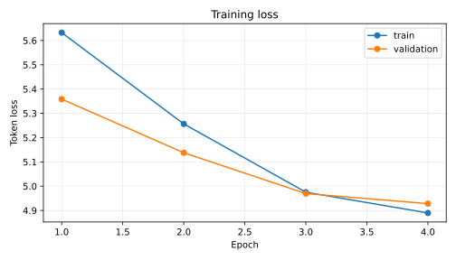
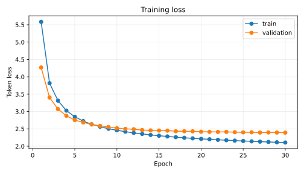
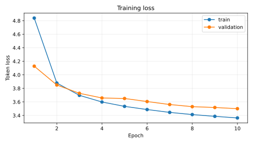
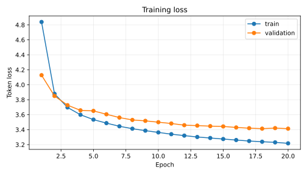

# Transformer From Scratch — PyTorch & TensorFlow

A from-scratch implementation of the original Transformer architecture
(*"Attention Is All You Need"*, Vaswani et al., 2017) built independently in
**PyTorch** and **TensorFlow/Keras**, with mirrored code structure so the two
implementations can be compared side by side.

No `nn.Transformer`, no `keras.layers.MultiHeadAttention` — every component
(embeddings, positional encoding, multi-head attention, encoder/decoder
stacks, masking, the warmup LR schedule) is implemented by hand in both
frameworks.

> 🚧 **Status:** Work in progress. Follow along via [`roadmap.md`](roadmap.md)
> for the day-by-day build log, and [`design.md`](design.md) for the full
> architecture and project design.

---

## Why this project

Most "transformer from scratch" repos pick one framework. This one
deliberately implements the **same architecture twice**, so the repo also
serves as a practical PyTorch-vs-TensorFlow comparison — in API ergonomics,
training loop design, and debugging experience. See `WRITEUP.md` (added
later in the build) for that comparison.

## Repository structure

```
Transformer-From-Scratch/
├── README.md
├── design.md              # full architecture & design decisions
├── roadmap.md             # day-by-day build plan
├── requirements-torch.txt
├── requirements-tf.txt
├── requirements-tf-gpu.txt          # TensorFlow + CUDA extras for Linux/WSL2
├── pytest.ini / Makefile
├── data/                                # shared, framework-agnostic (see design.md, Days 14-15)
│   ├── bpe_tokenizer.py                   # from-scratch BPE tokenizer
│   ├── build_vocab.py                     # CLI: train + save one shared vocab file
│   ├── parallel_data.py                   # read pairs, encode, pad, teacher-force, seeded batching
│   ├── download_multi30k.py               # fetch the real dataset (git-ignored once downloaded)
│   └── sample/                            # tiny hand-written EN/DE corpus to run everything now
├── tests/                             # framework-agnostic tests
│   ├── test_bpe_tokenizer.py            # Day 14 — pure stdlib
│   ├── test_parallel_data.py            # Day 15 — pure stdlib
│   ├── test_data_loader_parity.py       # Day 15 — both loaders yield identical batches
│   ├── weight_sync.py                   # copy weights from a torch module into its tf twin
│   ├── test_mha_parity.py               # weight-matched MultiHeadAttention parity (Day 6)
│   ├── test_ffn_residual_parity.py          # weight-matched FFN/LayerNorm parity (Day 8)
│   ├── test_encoder_parity.py           # weight-matched EncoderLayer parity (Day 9)
│   ├── test_encoder_stack_parity.py         # weight-matched full Encoder parity (Day 10)
│   ├── test_decoder_parity.py           # weight-matched DecoderLayer parity (Day 11)
│   ├── test_transformer_parity.py       # weight-matched FULL MODEL parity (Day 12)
│   └── ...                              # config / embeddings / attention parity
├── torch_impl/                          # PyTorch implementation
│   ├── config.py                          # TransformerConfig (identical to tf_impl/config.py)
│   ├── model/                              # masking, embeddings, attention, encoder, decoder, transformer
│   ├── data/dataset.py                     # TorchBatchLoader: shared batches -> torch.long tensors
│   ├── training/                            # NoamSchedule + padding-aware LabelSmoothingLoss (Day 16)
│   └── tests/                               # component, parity, dataset, and training utility tests
├── tf_impl/                              # TensorFlow implementation, mirrors torch_impl/
│   └── training/                            # Keras NoamSchedule + padding-aware label smoothing
├── notebooks/                              # attention visualization, framework comparison
└── assets/diagrams/                         # architecture diagrams, attention heatmaps
```

## Status / Progress

- [x] Day 1 — Repo scaffolding & environment setup
- [x] Day 2 — Config & masking utilities
- [x] Day 3 — Embeddings & positional encoding
- [x] Day 4 — Scaled dot-product attention (+ numerical parity check)
- [x] Day 5 — Multi-head attention
- [x] Day 6 — Weight-matched cross-framework parity check (MultiHeadAttention)
- [ ] Day 7 — Buffer / bug-fix day
- [x] Day 8 — Feed-forward network, residual connections & LayerNorm
- [x] Day 9 — Encoder layer
- [x] Day 10 — Encoder stack
- [x] Day 11 — Decoder layer
- [x] Day 12 — Decoder stack + full Transformer model assembly
- [x] Day 13 — Overfit test (tiny-data sanity check)
- [x] Day 14 — Shared BPE tokenizer & vocabulary
- [x] Day 15 — Dataset, padding & batching (shared pipeline + per-framework loaders)
- [x] Day 16 — Noam LR schedule + padding-aware label smoothing (PyTorch & TensorFlow)
- [x] Day 17 — PyTorch training loop and checkpointing
- [x] Day 18 — TensorFlow training loop and checkpointing
- [x] Day 19 — Reproducible PyTorch CUDA subset run with metrics, checkpoints & samples
- [x] Day 20 — Extended full-corpus PyTorch CUDA run (30 epochs / 13,620 steps)
- [x] Day 21 — TensorFlow CPU subset training with metrics, samples & resume
- [x] Day 22 — Extended TensorFlow CPU continuation to 20 epochs
- [x] Day 23 — Shared-corpus BLEU evaluation & side-by-side translations
- [ ] Day 24–28 — Visualization, comparison writeup, polish
- [ ] Day 29–30 — Stretch goal & final release

Full detail on each phase lives in [`roadmap.md`](roadmap.md).


### Day 16 — learning-rate schedule and label smoothing

Both frameworks now include the original Transformer warmup/inverse-square-root learning-rate schedule and label-smoothed token loss. The schedule follows

\[\mathrm{lr}(s)=d_{\mathrm{model}}^{-1/2}\min(s^{-1/2},s\cdot\mathrm{warmup}^{-3/2})\]

with a one-based public step in PyTorch; the Keras schedule translates its zero-based optimizer iteration to the same effective step. The loss ignores target positions equal to `pad_idx` and normalizes `mean` reduction by the number of non-padding target tokens, not by padded sequence length. It supports `none`, `sum`, and `mean` reductions, and an all-padding batch safely returns a differentiable zero.

```python
# PyTorch
from torch_impl.training.lr_schedule import NoamSchedule
from torch_impl.training.losses import LabelSmoothingLoss

schedule = NoamSchedule(d_model=config.d_model, warmup_steps=config.warmup_steps)
loss_fn = LabelSmoothingLoss(config.label_smoothing, pad_idx=config.pad_idx)
# Each optimizer update: schedule.apply(optimizer, global_step)
loss = loss_fn(logits, batch.tgt_out)
```

```python
# TensorFlow / Keras
from tf_impl.training.lr_schedule import NoamSchedule
from tf_impl.training.losses import LabelSmoothingLoss

optimizer = tf.keras.optimizers.Adam(learning_rate=NoamSchedule(config.d_model, config.warmup_steps))
loss_fn = LabelSmoothingLoss(config.label_smoothing, pad_idx=config.pad_idx)
loss = loss_fn(batch.tgt_out, logits)  # Keras convention: targets first
```

Validation: `torch_impl/tests/test_training_utils.py` and `tf_impl/tests/test_training_utils.py` cover the schedule formula/peak/decay, configuration errors, zero-smoothing equivalence to ordinary cross-entropy, padding exclusion, reductions, and finite gradients. Both framework suites and their cross-framework parity tests are exercised by the full test command. The Day 17 PyTorch and Day 18 TensorFlow training loops are implemented; full-scale framework comparison runs are scheduled for Days 19–23.

### Day 17 — PyTorch training loop and checkpointing

The PyTorch training entry point now connects the shared parallel-data pipeline, Transformer, Noam schedule, and padding-aware label-smoothed loss. It supports teacher-forced training, gradient clipping, validation loss, token-throughput and learning-rate logging, reproducible epoch shuffling, atomic `latest.pt`/`best.pt` checkpoints, and resuming model/optimizer/RNG state. Tokenizer training uses training text only.

Run from the repository root after installing `requirements-torch.txt`:

```bash
# Quick end-to-end smoke run on the bundled sample corpus
python -m torch_impl.training.train --epochs 1 --batch-size 4 --vocab-size 64 --max-len 16 --warmup-steps 4

# Resume from the latest checkpoint
python -m torch_impl.training.train --resume checkpoints/torch/latest.pt

# Use your own parallel files
python -m torch_impl.training.train --train-src data/train.en --train-tgt data/train.de \
  --val-src data/val.en --val-tgt data/val.de --epochs 20 --batch-size 64
```

If `--tokenizer` does not point to an existing tokenizer, it is trained and saved there from the training source and target files. If `--config` is supplied, its source and target vocabulary sizes must match the tokenizer. Checkpoints and `history.jsonl` are written to `checkpoints/torch/` by default; checkpoint files are ignored by Git. For repeatable small CPU smoke tests, pass `--num-threads 1`.

Validation in this environment: `python -m pytest torch_impl/tests/test_train_loop.py torch_impl/tests/test_training_utils.py tests/test_parallel_data.py tests/test_bpe_tokenizer.py -q` passed, and end-to-end training plus checkpoint resume completed successfully on CUDA. GPU is the default; pass `--device cpu` only when CPU execution is intentional.

### Day 18 — TensorFlow training loop and checkpointing

The TensorFlow entry point mirrors Day 17 using `tf.GradientTape`, the shared English–German data pipeline and batching order, Keras Adam with the same Noam schedule, and padding-aware label smoothing. It logs train/validation token loss, learning rate, token throughput, and elapsed time. It clips gradients, fails fast on non-finite loss/gradients, and saves TensorFlow `latest` and `best` checkpoint-manager directories alongside `config.json` and append-only `history.jsonl`. Resume restores model, optimizer slots, epoch, and best validation loss.

Run inside the TensorFlow virtual environment from the repository root:

```bash
# One-epoch smoke run using the bundled sample corpus
python -m tf_impl.training.train --epochs 1 --batch-size 4 --vocab-size 64 --max-len 16 --warmup-steps 4

# Resume from the latest checkpoint-manager directory
python -m tf_impl.training.train --resume checkpoints/tf/latest

# Use your own parallel files
python -m tf_impl.training.train --train-src data/train.en --train-tgt data/train.de \
  --val-src data/val.en --val-tgt data/val.de --epochs 20 --batch-size 64

# Day 18 regression tests
python -m pytest tf_impl/tests/test_train_loop.py tf_impl/tests/test_training_utils.py -q
```

Checkpoints and logs are written to `checkpoints/tf/` by default and are excluded from Git. The TensorFlow training tests, end-to-end sample-corpus run, checkpoint save, and checkpoint resume path have all been validated with TensorFlow 2.21 / Keras 3.13.

### Day 19 — PyTorch CUDA training run

Day 19 adds deterministic `--max-train-pairs` / `--max-val-pairs` controls,
greedy validation translations after every epoch, `translations.jsonl`, and
an automatically refreshed SVG loss curve. A real run completed on CUDA using
2,000 Multi30k training pairs, 200 validation pairs, a joint 512-token BPE
vocabulary, and the checked-in `configs/day19-torch.json` configuration.
Checkpoint resume was then verified by restoring epoch 3 and completing epoch 4.

```bash
python -m torch_impl.training.train \
  --config configs/day19-torch.json \
  --train-src data/multi30k/train.en --train-tgt data/multi30k/train.de \
  --val-src data/multi30k/val.en --val-tgt data/multi30k/val.de \
  --max-train-pairs 2000 --max-val-pairs 200 --vocab-size 512 \
  --tokenizer checkpoints/day19/tokenizer.json \
  --checkpoint-dir checkpoints/day19/torch --sample-translations 3
```

Training loss decreased from 5.6325 to 4.8897 and validation loss from
5.3585 to 4.9280 over 128 optimizer steps. The compact reproducibility
artifacts are in [`results/day19/`](results/day19/); model checkpoints remain
git-ignored because of their size.



### Day 20 — Extended PyTorch CUDA training run

The initial Day 20 run extended the Day 19 subset checkpoint to 40 epochs.
The enhanced run then removed that quality ceiling: it uses all 29,000
Multi30k training pairs and all 1,014 validation pairs, a 2,048-token joint BPE
vocabulary, and a 1.92M-parameter pre-norm Transformer (`d_model=128`, three
encoder/decoder layers). It completed 30 CUDA epochs and 13,620 optimizer
steps, with only three training pairs truncated at the 64-token limit.

The shared from-scratch BPE tokenizer now caches repeated word encodings and
applies only merge pairs present in each word. The ranked implementation was
verified against the original learned-order algorithm on all 25,792 distinct
words in the bilingual training corpus. Tokenizer saves also create missing
parent directories.

```bash
python -m torch_impl.training.train \
  --config configs/day20-full-torch.json \
  --train-src data/multi30k/train.en --train-tgt data/multi30k/train.de \
  --val-src data/multi30k/val.en --val-tgt data/multi30k/val.de \
  --vocab-size 2048 --tokenizer checkpoints/day20-full/tokenizer.json \
  --checkpoint-dir checkpoints/day20-full/torch --sample-translations 3
```

Training loss decreased from 5.5842 to 2.1063 and validation loss from 4.2692
to 2.3910. The final epoch is also the best checkpoint. Qualitative samples
now preserve sentence-specific subjects, actions, colors, objects, and
relationships instead of collapsing to a generic caption. Formal BLEU scoring
remains a Day 23 task. Reproducibility artifacts and the exact tokenizer are in
[`results/day20-full/`](results/day20-full/); the earlier subset artifacts are
retained in [`results/day20/`](results/day20/) for comparison.



### Day 21 — TensorFlow CPU training run

Day 21 brings the TensorFlow CLI to feature parity with the PyTorch training
workflow: deterministic train/validation subset controls, greedy validation
samples, `translations.jsonl`, an SVG loss curve, and clean log initialization
for fresh runs. The selected tokenizer is trained only on the selected
training pairs.

Because TensorFlow 2.21 cannot use CUDA on native Windows, the verified run
used `/device:CPU:0` with 5,000 Multi30k training pairs, 500 validation pairs,
the 512-token joint BPE vocabulary, and the 299,776-parameter compact model.
Epochs 1–9 ran in the initial process; epoch 10 restored model weights, Adam
slots, epoch 9, optimizer step 711, and best-validation state from the latest
checkpoint before completing step 790.

```bash
python -m tf_impl.training.train \
  --config configs/day21-tf.json --device cpu \
  --train-src data/multi30k/train.en --train-tgt data/multi30k/train.de \
  --val-src data/multi30k/val.en --val-tgt data/multi30k/val.de \
  --max-train-pairs 5000 --max-val-pairs 500 --vocab-size 512 \
  --tokenizer checkpoints/day21-medium/tokenizer.json \
  --checkpoint-dir checkpoints/day21-medium/tf --sample-translations 3
```

Training loss decreased from 4.8390 to 3.3631 and validation loss from 4.1279
to 3.4998. The final epoch is also the best checkpoint. The compact CPU run is
an execution and learning verification; translations remain limited and are
not presented as a quality match for the much larger full-corpus PyTorch run.
Artifacts are in [`results/day21/`](results/day21/).



### Day 22 — Extended TensorFlow CPU training run

Day 22 restored the verified Day 21 checkpoint at epoch 10 and optimizer step
790, then continued the identical 5,000/500-pair TensorFlow experiment through
epoch 20 and step 1,580. Model weights, Adam slots, epoch, optimizer iteration,
and best-validation state were restored before training continued on
`/device:CPU:0`.

```bash
python -m tf_impl.training.train \
  --config configs/day22-tf.json --device cpu \
  --train-src data/multi30k/train.en --train-tgt data/multi30k/train.de \
  --val-src data/multi30k/val.en --val-tgt data/multi30k/val.de \
  --max-train-pairs 5000 --max-val-pairs 500 \
  --tokenizer checkpoints/day21-medium/tokenizer.json \
  --checkpoint-dir checkpoints/day21-medium/tf --sample-translations 3 \
  --resume checkpoints/day21-medium/tf/latest
```

Between epochs 10 and 20, training loss improved from 3.3631 to 3.2172 and
validation loss from 3.4998 to 3.4132. Across the complete 20-epoch history,
the reductions are 33.5% and 17.3%, respectively. Epoch 20 is both the latest
and best checkpoint. Greedy samples remain weak because the run deliberately
keeps the compact CPU configuration; formal corpus-level evaluation remains
the Day 23 task. Artifacts are in [`results/day22/`](results/day22/).



### Day 23 — Cross-framework evaluation

Day 23 adds a reusable evaluation CLI that strictly restores both best
checkpoints, greedily translates the same validation examples, computes
lowercase tokenized corpus BLEU-4, and writes machine-readable metrics plus
side-by-side qualitative outputs. The metric uses the repository's Unicode
word/punctuation tokenizer and exponential zero-count smoothing, so it remains
fully reproducible without a network-installed metric dependency.

```bash
python -m evaluation.evaluate --max-pairs 100 \
  --torch-checkpoint checkpoints/day20-full/torch/best.pt \
  --torch-tokenizer checkpoints/day20-full/tokenizer.json \
  --torch-device cuda \
  --tf-checkpoint checkpoints/day21-medium/tf/best \
  --tf-config checkpoints/day21-medium/tf/config.json \
  --tf-tokenizer checkpoints/day21-medium/tokenizer.json \
  --tf-device cpu --output-dir results/day23
```

On the first 100 shared Multi30k validation examples, the PyTorch model scored
37.8505 BLEU and the TensorFlow model scored 1.6422 BLEU. PyTorch decoded at
1.957 sentences/s on CUDA; TensorFlow decoded at 0.274 sentences/s on CPU.
This is a checkpoint comparison, not a controlled framework benchmark: the
PyTorch model used the full 29,000-pair corpus, 2,048-token vocabulary, and
1.92M parameters, while TensorFlow used 5,000 pairs, 512 tokens, and 300k
parameters. Full metrics and examples are in
[`results/day23/`](results/day23/).

The evaluator reconstructs TensorFlow's full checkpoint object graph—including
optimizer slots and state variables—before restoring. A regression test guards
this because a model-only object restore can appear successful while resolving
the object graph incorrectly.

## Setup

**PyTorch environment**
```bash
python -m venv .venv-torch
# Linux/macOS: source .venv-torch/bin/activate
# Windows PowerShell: .venv-torch\Scripts\Activate.ps1
pip install -r requirements-torch.txt
```

**TensorFlow environment**
```bash
python -m venv .venv-tf
# Linux/macOS: source .venv-tf/bin/activate
# Windows PowerShell: .venv-tf\Scripts\Activate.ps1

# GPU training on a supported Linux/WSL2 NVIDIA system
pip install -r requirements-tf-gpu.txt

# CPU-only development/tests
# pip install -r requirements-tf.txt
```

## GPU execution

Training is GPU-first in both implementations:

- PyTorch defaults to `--device cuda` and exits if CUDA is unavailable. Use
  `--device cpu` or `--device auto` only when fallback behavior is intentional.
- TensorFlow defaults to `--device gpu`, enables memory growth on every visible
  GPU, and exits if no TensorFlow GPU device is available. Use `--device cpu`
  or `--device auto` explicitly for non-GPU runs.
- TensorFlow 2.11 and later do not support CUDA on native Windows. Use a
  supported Linux or WSL2 NVIDIA environment with `requirements-tf-gpu.txt`.
  PyTorch CUDA continues to work natively on Windows.

## Running the tests

Each framework's tests run in its own virtualenv; the framework-agnostic tests in
`tests/` run in either.

```bash
# PyTorch env
make test-torch        # everything, including the ~600-step Day 13 overfit test
make test-torch-fast   # == python -m pytest tests torch_impl -m "not slow"

# TensorFlow env
make test-tf            # everything, including the Day 13 overfit test
make test-tf-fast       # == python -m pytest tests tf_impl -m "not slow"

# No framework needed (tokenizer + data pipeline)
make test-data
```

`tests/test_config_parity.py`, `tests/test_embeddings_parity.py`, `tests/test_attention_parity.py`, `tests/test_mha_parity.py`, `tests/test_ffn_residual_parity.py` and `tests/test_encoder_parity.py` only run if *both* frameworks are importable in the active environment; otherwise pytest reports them as skipped, which is expected.

The parameter-free ones (config, positional encoding, raw attention) compare math directly on identical inputs. The weight-bearing ones (`MultiHeadAttention`, `PositionwiseFeedForward`, `ResidualConnection`'s LayerNorm, and now the full `EncoderLayer`) use `tests/weight_sync.py` to copy the *same* weights from the PyTorch module into its TensorFlow twin first — accounting for PyTorch's `(out, in)` Linear layout vs. Keras' `(in, out)` Dense layout — before comparing outputs. `test_mha_parity.py` additionally includes a negative control confirming the two frameworks genuinely diverge *without* syncing, so parity can't trivially pass for the wrong reason.

LayerNorm's epsilon is pinned to `1e-6` explicitly on both sides — PyTorch's `nn.LayerNorm` default is `1e-5` and Keras' `LayerNormalization` default is `1e-3`, and leaving either at its default would have silently broken this parity check.

`torch_impl/tests/test_encoder.py` and `tf_impl/tests/test_encoder.py` also each check a structural property, not just shapes: perturbing *only* the padded positions of the input must leave the encoder's output at the real positions unchanged. That's an easy property to silently break (e.g. a mask applied to the wrong axis) and a cheap, high-value thing to test for.

`test_encoder_stack.py` (Day 10) checks that property *survives stacking* N layers deep, and adds two more stack-specific checks: the N layers must have genuinely independent weights (not six references to one set — that would silently collapse the stack's capacity to a single layer), and a deeper stack must actually produce a different output than a shallow one on the same input.

`test_decoder.py` (Day 11) checks three analogous invariants for the decoder layer: the causal mask blocks future target positions (perturbing position 4 must not change the output at position 1), the cross-attention memory mask blocks padded *source* positions, and — the easy-to-get-wrong direction — changing *non-padded* encoder memory actually does change the decoder's output, proving cross-attention isn't accidentally a no-op.

**Day 12 covers the full model forward path.** `test_transformer.py` checks the assembled model end-to-end: output logit shapes, `create_masks()` matches the raw masking function, `encode()`+`decode()`+output projection called manually matches calling the model directly, `from_config()` builds the right shapes, and `share_embeddings=True` genuinely reuses one module/layer (checked with `is`, not just equal values) while rejecting mismatched vocab sizes. One regression test exists specifically because of a bug this build caught itself: the PyTorch model's Xavier-init pass touches every >1-D parameter, which would silently re-randomize the token embedding's zeroed pad row (Day 3) the moment the full model is assembled — `_init_parameters()` now explicitly re-zeros it afterward, and a test locks that in. `test_transformer_parity.py` is the capstone: every weight across both embeddings, every encoder/decoder layer, and the output projection is synced, and the two frameworks must then produce identical logits — with no masks, with real padding+causal masks, and with `share_embeddings=True`. End-to-end training and checkpoint behavior is covered by the Day 17–18 suites.

**Day 13 is the first test that actually trains anything.** `test_overfit.py` (in each framework's own `tests/`, not the shared `tests/`, since it needs a real optimizer) builds a tiny Transformer and trains it with Adam for ~600 full-batch steps on 12 fixed sequences from a trivial copy task (no tokenizer or dataset needed yet — that's Day 14-15). It asserts the loss starts near `ln(vocab_size)` (confirming nothing is already broken at initialization), drops by at least 5x, and the model reaches >90% token accuracy on the memorized sequences. This is the first test that would actually catch a subtly-broken gradient anywhere in the 12-day chain of composed modules — everything before it checked shapes, masks, and cross-framework numerics, but never "can this thing learn anything at all". It's marked `slow` and run by `make test-torch`/`make test-tf`; use the `-fast` targets to skip it during quick iteration.

**Day 14's tokenizer tests are the first ones with zero framework dependency.** `data/bpe_tokenizer.py` and `tests/test_bpe_tokenizer.py` are pure stdlib (same as `config.py`) — `python -m pytest tests/test_bpe_tokenizer.py` runs with no torch or tensorflow installed at all, in either virtualenv or a bare Python install. It checks the BPE algorithm against a hand-computable case (`'aaab'` must merge `('a','a')` first — more mergeable pairs than any other adjacent pair), training determinism (train twice on the same corpus, get byte-identical vocab and merges — what lets both frameworks' Day-15 data loaders train independently and still agree), encode/decode roundtripping, and that the tokenizer's special-token ids line up exactly with `config.py`'s `PAD_IDX`/`BOS_IDX`/`EOS_IDX`/`UNK_IDX`.

**Day 15 keeps the data pipeline shared too.** `tests/test_parallel_data.py` is also pure stdlib. It checks that misaligned parallel files are rejected (including a U+2028 character that `str.splitlines()` would silently split on), that every sentence is wrapped in BOS/EOS and truncation never loses the EOS, the teacher-forcing shift (decoder input = target minus its last position, labels = target minus BOS, exactly one EOS label per sentence and only padding after it), and that batch order is a pure function of `(seed, epoch)`. `torch_impl/tests/test_dataset.py` and `tf_impl/tests/test_dataset.py` then check the tensors match the shared batches value-for-value, that batch shapes line up with Day 2's masks (padded source positions blocked, no position sees a later one), and that a real batch flows through the full model to a finite, ignore-pad loss. `tests/test_data_loader_parity.py` asserts the two loaders yield identical batches across epochs.

### Data quick start

```bash
# 1. Try it now on the bundled 24-pair sample (joint EN+DE vocab)
python -m data.build_vocab --files data/sample/train.en data/sample/train.de \
    --vocab-size 300 --out data/sample/tokenizer.json

# 2. Or fetch the real Multi30k and build a bigger vocab
python -m data.download_multi30k
python -m data.build_vocab --files data/multi30k/train.en data/multi30k/train.de \
    --vocab-size 8000 --out data/multi30k/tokenizer.json
```

The vocab is **joint** (English and German together), so both sides share ids and `share_embeddings=True` is available; set `src_vocab_size`/`tgt_vocab_size` in the config to `tokenizer.vocab_size`.

## Conventions shared by both implementations

- **Masks are boolean, `True` = may attend, `False` = blocked**, and broadcast to
  `(batch, heads, q_len, k_len)`.
- **Special tokens:** `PAD=0, BOS=1, EOS=2, UNK=3`.
- **One `TransformerConfig`** per framework with identical fields/defaults; a test
  fails if they ever drift.

## License

MIT — see [LICENSE](LICENSE).
