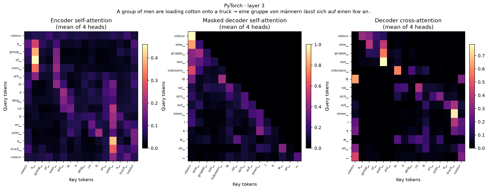
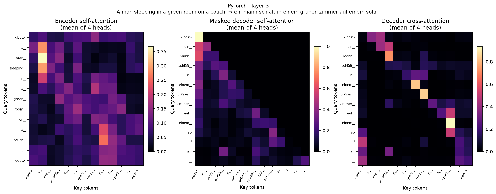
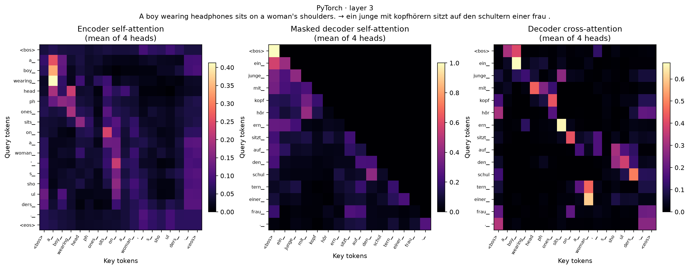
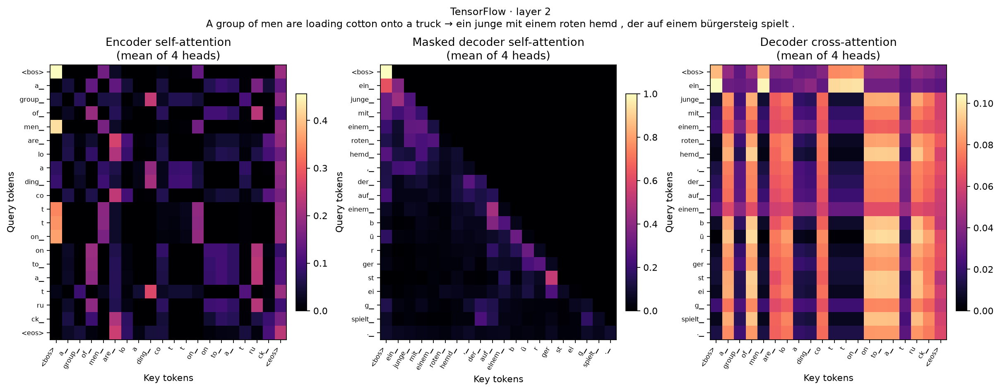
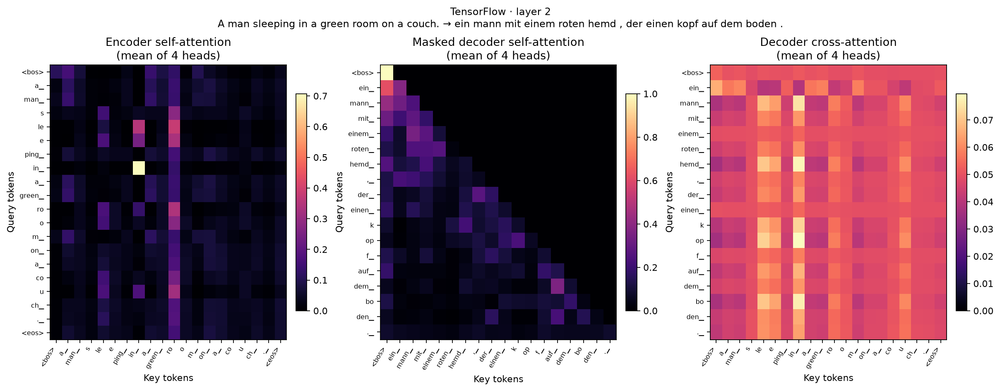
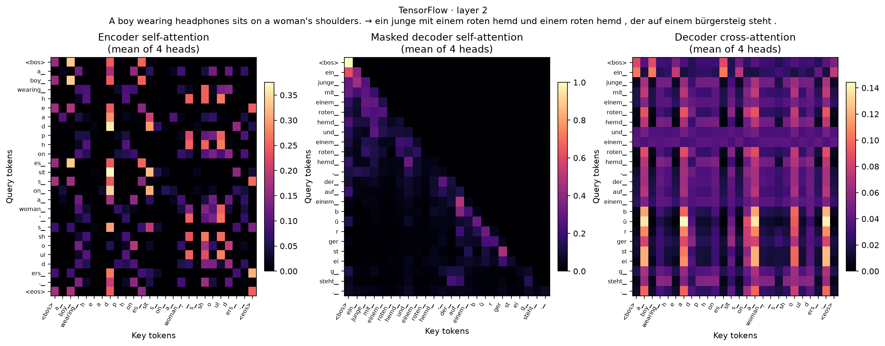

# Day 24 — Attention visualization

Each figure uses the selected layer and averages its individual attention heads for readability. Exact per-head matrices are stored in `attention.json`.

## PyTorch example 1

- Source: A group of men are loading cotton onto a truck
- Reference: Eine Gruppe von Männern lädt Baumwolle auf einen Lastwagen
- Translation: eine gruppe von männern lässt sich auf einen lkw an .
- Layer: 3

## PyTorch example 2

- Source: A man sleeping in a green room on a couch.
- Reference: Ein Mann schläft in einem grünen Raum auf einem Sofa.
- Translation: ein mann schläft in einem grünen zimmer auf einem sofa .
- Layer: 3

## PyTorch example 3

- Source: A boy wearing headphones sits on a woman's shoulders.
- Reference: Ein Junge mit Kopfhörern sitzt auf den Schultern einer Frau.
- Translation: ein junge mit kopfhörern sitzt auf den schultern einer frau .
- Layer: 3

## TensorFlow example 1

- Source: A group of men are loading cotton onto a truck
- Reference: Eine Gruppe von Männern lädt Baumwolle auf einen Lastwagen
- Translation: ein junge mit einem roten hemd , der auf einem bürgersteig spielt .
- Layer: 2

## TensorFlow example 2

- Source: A man sleeping in a green room on a couch.
- Reference: Ein Mann schläft in einem grünen Raum auf einem Sofa.
- Translation: ein mann mit einem roten hemd , der einen kopf auf dem boden .
- Layer: 2

## TensorFlow example 3

- Source: A boy wearing headphones sits on a woman's shoulders.
- Reference: Ein Junge mit Kopfhörern sitzt auf den Schultern einer Frau.
- Translation: ein junge mit einem roten hemd und einem roten hemd , der auf einem bürgersteig steht .
- Layer: 2

