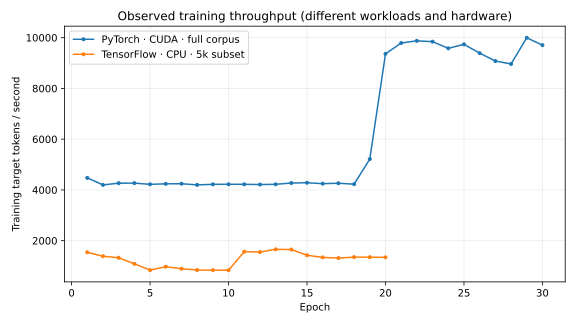

# Day 25 — PyTorch vs TensorFlow comparison

> **Interpretation boundary:** these are observed project runs, not a controlled framework benchmark. Hardware, model capacity, data volume, vocabulary, normalization, sequence length, and epoch count differ.

## Measured results

| Metric | PyTorch | TensorFlow |
|---|---:|---:|
| Device | NVIDIA Quadro M2000M CUDA (4 GB) | Native Windows CPU |
| Training pairs | 29,000 | 5,000 |
| Parameters | 1,915,392 | 299,776 |
| Parameter memory (MiB) | 7.31 | 1.14 |
| Best checkpoint size (MiB) | 22.09 | 3.49 |
| Mean train tokens/s | 6,234 | 1,256 |
| Best validation loss | 2.3910 | 3.4132 |
| BLEU-4 (100 shared examples) | 37.8505 | 1.6422 |
| Decode sentences/s | 1.957 | 0.274 |
| Implementation Python files | 16 | 16 |
| Nonblank/non-comment lines | 1,234 | 1,338 |

Checkpoint size includes the saved optimizer/progress state. Parameter memory assumes the actual trainable-variable dtypes. Peak runtime memory was not recorded, so no peak-memory claim is made.

## Engineering comparison

| Area | PyTorch | TensorFlow/Keras |
|---|---|---|
| Model API | `nn.Module.forward`; explicit device movement | `Layer.call`; variables build lazily |
| Training | Direct `zero_grad/backward/step` flow | Explicit `GradientTape` with gradient application |
| Debugging | Eager tensors and Python stack traces were direct | Eager mode was inspectable; lazy variable creation and checkpoint object graphs required extra care |
| Checkpoints | One atomic payload with model, optimizer, RNG, and progress | Trackable object graph plus checkpoint managers; full graph must be recreated before restore |
| GPU in this environment | Native Windows CUDA worked | TensorFlow 2.11+ required Linux/WSL2 for CUDA, so this run used CPU |
| Code verbosity | Slightly fewer measured implementation lines | Slightly more glue for `training=` propagation, variable building, and checkpoint restoration |

See [`WRITEUP.md`](../../WRITEUP.md) for design decisions and the full interpretation of these measurements.
